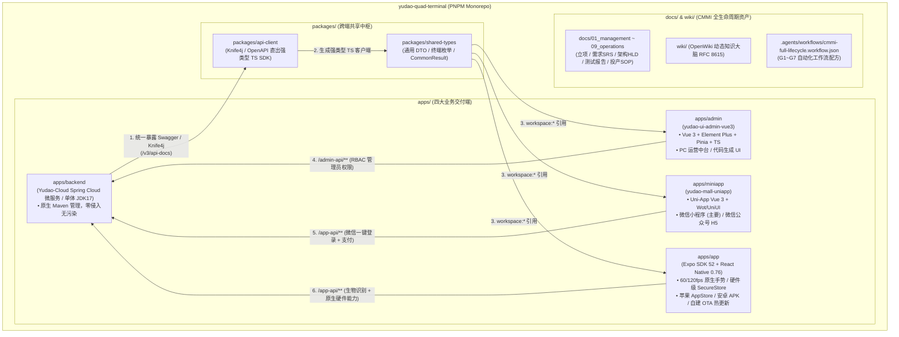

# yudao-quad-terminal

[](https://openjdk.org/projects/jdk/17/)
[](https://spring.io/projects/spring-boot)
[](https://vuejs.org/)
[](https://uniapp.dcloud.net.cn/)
[](https://expo.dev/)
[](docs/01_management/project-charter.md)
[](LICENSE)

> 🚀 **工业级 AI 原生商业软件四位一体超级基座 (Integrated Quad-Terminal Foundry Base)**  
> 统一收拢 **Java 微服务后端 (Spring Cloud / JDK 8/17/21) + PC 运营管理后台 (Vue3 Element Plus) + 微信生态端 (Uni-App 小程序) + 原生移动客户端 (Expo SDK 52 / React Native 0.76)** 四大终端形态，内置 CMMI 01~09 全生命周期工程真资产与 OpenWiki 知识大脑。

---

## 🌿 JDK 多版本分支矩阵 (JDK Version Branches)

针对企业客户的不同技术基线，本基座提供三大 JDK 分支，**三端代码 (Vue3/UniApp/Expo) 与 CMMI 资产完全通用，后端底层自由切换**：

| 分支名 | JDK 版本 | Spring Boot | 核心特性 | 适用交付场景 |
| :--- | :--- | :--- | :--- | :--- |
| **`main` / `master-jdk17`** *(默认)* | **JDK 17 (LTS)** | `3.5.15` (Spring Boot 3) | Jakarta EE 10 / 原生集成 Spring AI / Knife4j 4.5+ | **现代商业交付首选**（默认工业黄金标准） |
| **`master-jdk8`** | **JDK 8** | `2.7.18` (Spring Boot 2) | Java EE javax.* / 经典持久层与全套旧版中间件 | **政企 / 国企专网**（存量 CentOS 7 等老基座） |
| **`master-jdk21`** | **JDK 21 (LTS)** | `3.5.15` (Spring Boot 3) | Project Loom 虚拟线程 / 分代 ZGC 超低延时 | **新一代高并发 / AI 流式智算平台** |

---

## 🏛️ 物理拓扑与架构总览 (Architecture Topology)



---

## ⚡ 极速起步 (Quick Start)

### 1. 依赖安装
```bash
# 安装前端多端与跨端共享包依赖 (自动识别 pnpm workspace)
pnpm install
```

### 2. 多端并发启动
```bash
# 1. 启动 Java 后端 (单体聚合本地模式，监听 48080)
pnpm backend:run

# 2. 启动 PC 运营管理后台 (监听 3000)
pnpm dev:admin

# 3. 启动微信小程序构建
pnpm dev:miniapp

# 4. 启动 Expo 原生 App (Metro Bundler)
pnpm dev:app
```

### 3. 后端接口契约同步 (从 Knife4j 生成前端 TS SDK)
当后端 Java Controller 增加或修改接口后，一键转译：
```bash
pnpm gen:api-sdk
```
前端三端（Admin / MiniApp / Expo App）即刻获得强类型提示与编译期类型保护。

---

## 📦 零历史秒级派生新项目 (Zero-Git-History Hatching)

立项新客户交付工程时，只需一句命令，10 秒内即可派生出一个全新、独立、包含四端多端与 CMMI 01~09 规范的商业工程：

```bash
# 方案 A: 使用 degit 极速拉取 (0MB 历史提交)
npx degit xaicd/yudao-quad-terminal#main my-new-project

# 方案 B: 在 Coolie 工坊中通过孵化器派生
bash scripts/hatch-client-project.sh /path/to/project --profile quad-terminal --title "客户项目名称"
```

---

## 📋 四大终端生态与定位矩阵

| 终端形态 | 目录位置 | 技术栈 | 业务角色与定位 | Yudao 路由与鉴权 |
| :--- | :--- | :--- | :--- | :--- |
| **Java 微服务后端** | `apps/backend` | Spring Cloud / JDK 17 / MyBatis-Plus | 业务中枢、分布式事务、规则引擎 | `/admin-api` 与 `/app-api` 双入口 |
| **PC 运营管理端** | `apps/admin` | Vue 3 + Vite + Element Plus + Pinia | 掌柜、运营人员、财务对账大屏 | `/admin-api/**` (Terminal: 1) |
| **微信生态端** | `apps/miniapp` | Uni-App Vue 3 + Vite | 微信 C 端顾客、社群裂变、小程序微信支付 | `/app-api/**` (Terminal: 10) |
| **原生双端 APP** | `apps/app` | Expo 52 + React Native 0.76 | 核心 VIP 会员、前线外勤人员、掌柜移动驾驶舱 | `/app-api/**` (Terminal: 20) |

---

## 🛡️ CMMI 01~09 全生命周期工程规范

根目录下 `docs/` 严格遵循 CMMI 5 高成熟度资产规范：
- `docs/01_management/`：项目范围、立项章程 (Charter)、WBS 字典与风险台账 (RSKM)；
- `docs/02_requirements/`：IEEE 29148 / EARS 语法软件需求规格说明书 (SRS) 与双向需求跟踪矩阵 (RTM)；
- `docs/03_design/`：系统概要设计说明书 (HLD)、DAR 架构选型分析与接口契约 (LLD)；
- `docs/04_implementation/`：研发编码规范、防假 Mock 守卫与单向依赖规约；
- `docs/05_verification/`：四态真机测试验收报告 (Test Report) 与客户终验单 (UAT)；
- `docs/06_quality_assurance/`：SPC 统计过程控制与 5-Whys 缺陷预防报告 (CAR)；
- `docs/07_release/`：不可变制品指纹、生产部署拓扑与秒级回滚应急 SOP；
- `docs/08_sre/`：SLO/SLI 度量矩阵与站点可靠性应急复盘；
- `docs/09_operations/`：多租户开通治理与持续对账台账。

---

## 📜 许可证 (License)

本项目遵循 [MIT License](LICENSE)。
