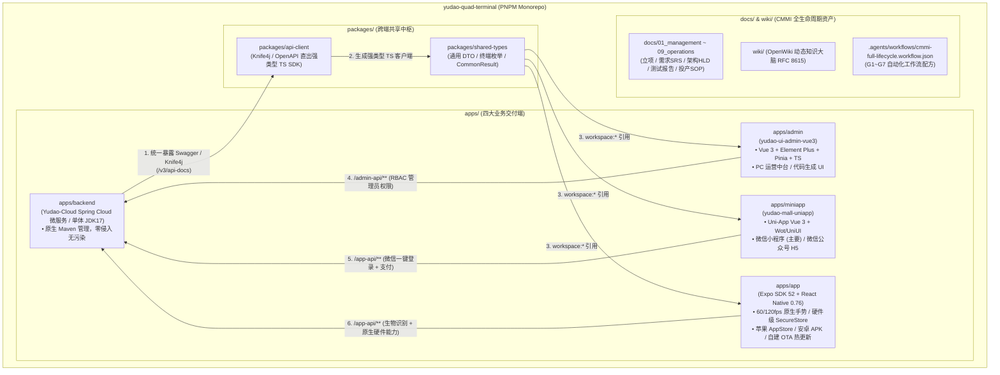

# yudao-quad-terminal

[](https://openjdk.org/projects/jdk/17/)
[](https://spring.io/projects/spring-boot)
[](https://vuejs.org/)
[](https://uniapp.dcloud.net.cn/)
[](https://expo.dev/)
[](docs/01_management/project-charter.md)
[](LICENSE)

> 🚀 **工业级 AI 原生商业软件四位一体超级基座 (Integrated Quad-Terminal Foundry Base)**  
> 统一收拢 **Java 微服务后端 (Spring Cloud / JDK 8/17/21) + PC 运营管理后台 (Vue3 Element Plus) + 微信生态端 (Uni-App 小程序) + 原生移动客户端 (Expo SDK 52 / React Native 0.76)** 四大终端形态，内置 CMMI 01~09 全生命周期工程真资产与 OpenWiki 知识大脑。

---

## 🌿 JDK 多版本分支矩阵 (JDK Version Branches)

针对企业客户的不同技术基线，本基座提供**四档 JDK 变体**（上游以**分支或标签**承载，真实 ref 由 `pnpm jdk:list` 实时解析），**三端代码 (Vue3/UniApp/Expo) 与 CMMI 资产完全通用，后端底层自由切换**：

| 变体 ref | JDK 版本 | Spring Boot | 核心特性 | 适用交付场景 |
| :--- | :--- | :--- | :--- | :--- |
| **`master-jdk17`** *(默认分支)* | **JDK 17 (LTS)** | `3.5.15` | Jakarta EE 10 / 原生集成 Spring AI / Knife4j 4.5+ | **现代商业交付首选**（默认工业黄金标准） |
| **`master-jdk17`** + `java.version=21` | **JDK 21 (LTS)** | `3.5.15` | Project Loom 虚拟线程 / 分代 ZGC 超低延时 | **新一代高并发 / AI 流式智算平台**（与 17 同分支，仅置换 pom 版本号） |
| **`master`** *(JDK 8 线分支)* / 标签 **`v2026.09(jdk8/11)`** | **JDK 8 / 11** | `2.7.18` (Spring Boot 2) | Java EE javax.* / 经典持久层与全套旧版中间件 | **政企 / 国企专网**（存量 CentOS 7 等老基座） |
| **`master-jdk25`** | **JDK 25** | `4.1.0` (Spring Boot 4) | 跟踪下一代 LTS 与 Spring Boot 4.x | 前沿技术预研 |

> ⚠️ 上游 `YunaiV/yudao-cloud` 的分支只有 `master-jdk17`（默认）、`master`（**JDK 8 线**）、`master-jdk25` 与 `develop` —— 没有 ~~master-jdk8~~ / ~~master-jdk21~~；JDK 8/11 另有发布标签 `v2026.09(jdk8/11)`，JDK 21 与 17 共用 `master-jdk17`。
> 上表所有「声明值」都会由 `jdk-variants` 门禁**读取对应 ref 的 pom 实测值反向核对**（防名字与内容不符）；真源为 [`scripts/lib/jdk-variants.mjs`](scripts/lib/jdk-variants.mjs)。
> 查询与切换：`pnpm jdk:list` / `pnpm jdk:status` / `pnpm jdk:use <jdk17-21|jdk8-11|jdk25>`。

---

## 🏛️ 物理拓扑与架构总览 (Architecture Topology)



---

## ⚡ 极速起步 (Quick Start)

### 1. 依赖安装
```bash
# 安装前端多端与跨端共享包依赖 (自动识别 pnpm workspace)
pnpm install
```

### 2. 多端并发启动
```bash
# 1. 启动 Java 后端 (单体聚合本地模式，监听 48080)
pnpm backend:run

# 2. 启动 PC 运营管理后台 (监听 3000)
pnpm dev:admin

# 3. 微信小程序（HBuilderX 工程，无 CLI dev 脚本）
pnpm dev:miniapp   # 打印 HBuilderX 打开指引

# 4. 启动 Expo 原生 App (Metro Bundler)
pnpm dev:app
```

### 3. 后端接口契约同步 (从 Knife4j 生成前端 TS SDK)
当后端 Java Controller 增加或修改接口后，一键转译：
```bash
pnpm gen:api-sdk
```
前端三端（Admin / MiniApp / Expo App）即刻获得强类型提示与编译期类型保护。

---

## 🚀 新方案速用（零 Docker / 统一门禁 / Agent 端点）

| 能力 | 一条命令 | 说明 | 详见 |
| :--- | :--- | :--- | :--- |
| **lite 零 Docker 档** | `pnpm lite:up` / `pnpm lite:down` | 嵌入式**真** PostgreSQL 18.4 + 嵌入式**真** Redis，无需 Docker、无需外部数据库/缓存服务 | [`deploy/lite/README.md`](deploy/lite/README.md) |
| **端到端验收** | `pnpm lite:verify` | 登录 200 + accessToken、**连续登录 3 次回归防护**、弱默认凭据反证、**子模块差异收敛复验**（改动必须恰好等于 deploy/patches 声明的补丁） | 同上 |
| **子模块差异补丁** | `pnpm patch:status` / `patch:apply` / `patch:check` | 代码级差异收敛于 `deploy/patches/`，子模块指针保持**纯上游提交** → 别人 clone 得到完整可用基座 | [`deploy/patches/README.md`](deploy/patches/README.md) |
| **统一门禁** | `pnpm gate:fast` / `pnpm gate:full` | `blocking` 才阻塞；`advisory` 如实展示；fast 15 项 / full 18 项（追加后端单测、前端构建与 lite e2e） | [`scripts/gate-check.mjs`](scripts/gate-check.mjs) |
| **自有脚本单测** | `pnpm test:scripts` | 44 个 `node:test` 用例：裁剪闭包/冲突、规格资产、凭据与加解密、进程收割边界、门禁 CLI | [`scripts/tests/`](scripts/tests) |
| **后端单测** | `pnpm test:all` | 脚本单测 + 类型 + `mvn test`（实测全绿约 72s）+ 就绪自检，**严格失败即退出** | [`scripts/lifecycle.sh`](scripts/lifecycle.sh) |
| **生产构建** | `pnpm build:backend` | 两步 Maven：依赖用普通库 jar、只 repackage 服务端 → 189MB（已实测） | [`scripts/build-admin.mjs`](scripts/build-admin.mjs) |
| **规格健康度** | `pnpm specs:health` | 校验每份规格的 16 份资产、brief 8 要素与占位符残留 | [`scripts/specs-health.mjs`](scripts/specs-health.mjs) |
| **模块裁剪** | `pnpm trim:modules --profile lite --dry-run` | 19 模块声明式裁剪：可预览 / 落地 / 校验漂移 / 一键撤销 | `.agents/skills/yudao-cloud-bootstrap/SKILL.md` §5 |
| **Agent 端点 (MCP)** | `cmd mcp list` | 8 个工具：裁剪、代码生成、上下文切片、契约防漂移、门禁 | [`.agents/skills/yudao-mcp-server/SKILL.md`](.agents/skills/yudao-mcp-server/SKILL.md) |

首次使用 lite 档：

```bash
cd deploy/lite/runtime && pnpm install   # 独立 workspace，务必在此目录安装
pnpm lite:up                             # 常驻；Ctrl-C 成对回收 Redis 与 java
```

> ⚠️ **构建 fat jar 必须两步**，否则会产出「fat jar 套 fat jar」，导致模块 bean 与 MyBatis Mapper 全部扫描不到：
> ```bash
> cd apps/backend
> mvn -B clean install -DskipTests -pl yudao-server -am -Dspring-boot.repackage.skip=true
> mvn -B package -DskipTests -pl yudao-server
> ```

### 工程硬约束

- **pnpm 唯一**：禁止任何 npm 操作（run / install / exec / ci 四类），由门禁 `pkg-manager` 拦截。`pnpm` 是唯一 JS 包管理器与任务入口。
- **`apps/backend`、`apps/admin`、`apps/miniapp` 是第三方 git submodule（只读）**：所有差异落主仓（`deploy/`、`scripts/`、`.agents/`、`docs/`）。
- **禁止弱默认凭据**（`admin` / `admin123` 之类）：lite 档引导凭据由 CSPRNG 生成，写入 `.commandcode/lite/credentials.env`（0600、已 gitignore）。
- **机器可读入口**：[`llms.txt`](llms.txt)；**Agent 导航**：[`AGENTS.md`](AGENTS.md) → [`wiki/index.md`](wiki/index.md)。

---

## 📦 零历史秒级派生新项目 (Zero-Git-History Hatching)

立项新客户交付工程时，只需一句命令，10 秒内即可派生出一个全新、独立、包含四端多端与 CMMI 01~09 规范的商业工程：

```bash
# 方案 A: 使用 degit 极速拉取 (0MB 历史提交)
pnpm dlx degit xaicd/yudao-quad-terminal#main my-new-project

# 方案 B: 使用仓内骨架派生器（可指定标题/包名，并跳过 git 初始化）
bash scripts/hatch.sh my-new-project --title "客户项目名称" --package com.example.myapp
```

---

## 📋 四大终端生态与定位矩阵

| 终端形态 | 目录位置 | 技术栈 | 业务角色与定位 | Yudao 路由与鉴权 |
| :--- | :--- | :--- | :--- | :--- |
| **Java 微服务后端** | `apps/backend` | Spring Cloud / JDK 17 / MyBatis-Plus | 业务中枢、分布式事务、规则引擎 | `/admin-api` 与 `/app-api` 双入口 |
| **PC 运营管理端** | `apps/admin` | Vue 3 + Vite + Element Plus + Pinia | 掌柜、运营人员、财务对账大屏 | `/admin-api/**` (Terminal: 1) |
| **微信生态端** | `apps/miniapp` | Uni-App Vue 3 + Vite | 微信 C 端顾客、社群裂变、小程序微信支付 | `/app-api/**` (Terminal: 10) |
| **原生双端 APP** | `apps/app` | Expo 52 + React Native 0.76 | 核心 VIP 会员、前线外勤人员、掌柜移动驾驶舱 | `/app-api/**` (Terminal: 20) |

---

## 🛡️ CMMI 01~09 全生命周期工程规范

根目录下 `docs/` 严格遵循 CMMI 5 高成熟度资产规范：
- `docs/01_management/`：项目范围、立项章程 (Charter)、WBS 字典与风险台账 (RSKM)；
- `docs/02_requirements/`：IEEE 29148 / EARS 语法软件需求规格说明书 (SRS) 与双向需求跟踪矩阵 (RTM)；
- `docs/03_design/`：系统概要设计说明书 (HLD)、DAR 架构选型分析与接口契约 (LLD)；
- `docs/04_implementation/`：研发编码规范、防假 Mock 守卫与单向依赖规约；
- `docs/05_verification/`：四态真机测试验收报告 (Test Report) 与客户终验单 (UAT)；
- `docs/06_quality_assurance/`：SPC 统计过程控制与 5-Whys 缺陷预防报告 (CAR)；
- `docs/07_release/`：不可变制品指纹、生产部署拓扑与秒级回滚应急 SOP；
- `docs/08_sre/`：SLO/SLI 度量矩阵与站点可靠性应急复盘；
- `docs/09_operations/`：多租户开通治理与持续对账台账。

---

## 📜 许可证 (License)

本项目遵循 [MIT License](LICENSE)。
