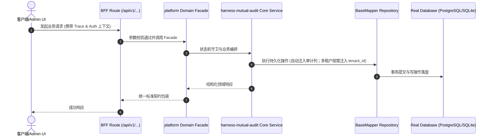

# Technical Architecture & Implementation Plan: 跨底座 Harness 交付闭环十维双向互审与自画像基线沉淀

> **Spec-Kit 架构与技术实施方案 (ADD: Architecture & Design Document)**
> 上游真源：`spec.md` (或 `requirements.md`)。技术方案严格支撑需求，严禁反向变更业务目标。
> 状态：`PLAN_APPROVED` | 所属领域：`platform` | 规格标识：`harness-mutual-audit`
> 对应项目宪法：`.specify/memory/constitution.md` (Rule 0.2 模式复用 / Rule 0.6 真实测试驱动 / Rule 0.8 E2E 任务同等对齐)

---

## 1. 关键不变量与防御性约束 (Key Invariants & Guards)

1. **门禁必咬人反向控制不变量** —— 通过 scripts/harness/negative-controls.mjs 对每道 blocking 门禁执行注入违规变红与字节级还原转绿验证
2. **规格包 16 资产齐备不变量** —— 由 scripts/specs-health.mjs 统一扫描活跃区与 archive 归档区，确保每份规格具备完整 16 件套且零占位符

## 2. 领域架构边界与调用拓扑 (Architecture Topology & Flows)

以 HARNESS.md、AGENTS.md、compat-manifest.json、llms.txt 与 wiki/index.md 五大核心入口为锚点，梳理 L0 兼容契约、L1 静态门禁、L2 脚本单测、L3 真 PG/Redis 验收、L4 构建产物、L5 全量门禁、L6 反向控制与 L7 派生金路径八层验证闭环，并与家族底座形成标准互认。

### 核心业务时序图 (Archify Mermaid Flow)

## 3. 技术选型与多端建设交付范围 (Technical Selection & Multi-Terminal Scope)

### 3.1 蓝图底座与核心选型论证 (DAR)
- **交付底座**: 优先采用 `cooliebase-all` (Next.js 16 + React 19 轻全栈) 或 `yudao-quad-terminal` (Java 微服务 + Vue3 + UniApp + Expo)；纯独立项目经评审后采用 bare。
- **数据存储**: 真实数据库 (PostgreSQL / MySQL / SQLite)，100% 拒绝内存伪造 Mock。
- **多租户能力状态**: **底座可选特性，按需开启**。单租户或企业私有化部署项目缺省关闭，杜绝硬塞无用租户样板代码。

### 3.2 多端建设覆盖矩阵
- **B端管理中台 (Admin Web)**: 负责运营配置、数据检索、系统流转与核销审核。
- **C端用户门户/商城 (2C Web/H5)**: 客户/终端用户业务办理与自闭环体验（按需）。
- **原生移动端 (Expo / React Native App)**: 6 寸屏单手可达、移动巡检与离线业务（按需）。
- **微信小程序端 (Uni-App)**: 微信生态社交裂变、轻量化业务触达（按需）。

## 4. 数据模型与持久化契约 (Data Model & Tables)

实体结构遵循底座基础审计规范：
- `id` (主键)
- `tenant_id` (多租户标识 —— **底座可选特性，按需开启；单租户/企业私有化业务缺省**)
- `creator` / `create_time` (创建人/时间)
- `updater` / `update_time` (更新人/时间)
- `deleted` (逻辑删除标识)
- `version` (乐观锁版本号，按需)

### 涉及实体与变更说明
- **compat-manifest.json**: 机器可读下游兼容契约文件，锁定入口脚本、lite 运行时端口、子模块指针与构建产物路径

## 5. API 契约与权限体系 (API Contracts & Security)

- **API 契约**: `/admin-api/platform/harness-mutual-audit`
- **权限标识**: `platform:harness-mutual-audit:query`, `platform:harness-mutual-audit:export`

## 6. 状态机流转与边界守卫 (State Machine Transitions)

- 勘察完成：self-portrait.md 已记录完整事实路径。
- 资产齐备：16 份 Spec-Kit 标准文档已生成并核销。
- 已归档：移入 docs/specs/archive/ 供后续架构演进查阅。

## 7. 技术风险评估与缓解策略 (Technical Risks & Mitigations)

- **风险**: 早期手工建立的互审目录仅含散落 Markdown，未纳入 Spec-Kit 16 件套标准管理 -> **缓释策略**: 补齐标准 brief.json 并通过 cmmi-02-requirements.cjs build 展开全套 16 份资产后归档至 docs/specs/archive/
