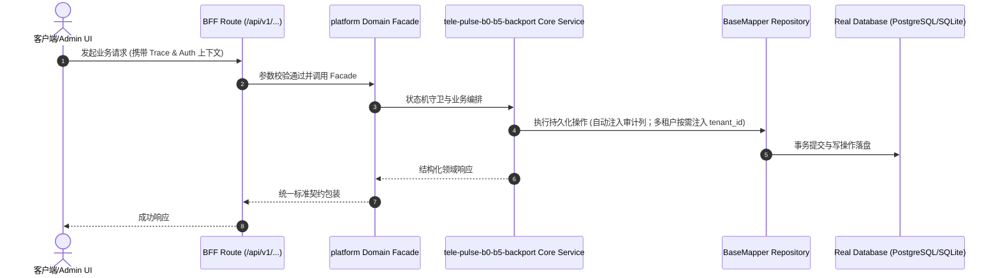

# Technical Architecture & Implementation Plan: 河北电信B0-B5全流程守卫、6端口Caddy、SWARM与23门禁反向回灌

> **Spec-Kit 架构与技术实施方案 (ADD: Architecture & Design Document)**
> 上游真源：`spec.md` (或 `requirements.md`)。技术方案严格支撑需求，严禁反向变更业务目标。
> 状态：`PLAN_APPROVED` | 所属领域：`platform` | 规格标识：`tele-pulse-b0-b5-backport`
> 对应项目宪法：`.specify/memory/constitution.md` (Rule 0.2 模式复用 / Rule 0.6 真实测试驱动 / Rule 0.8 E2E 任务同等对齐)

---

## 1. 关键不变量与防御性约束 (Key Invariants & Guards)

1. **导航菜单 <=4 字与前端净室不变量** —— menu-standard 门禁静态拦截超长菜单，lite-pg.mjs 启动与 domain-prune.mjs 自动执行数据库菜单收敛，project-reactor.mjs 派生时物理清除假图表与推广残留
2. **安全审计只追加防篡改不变量** —— three-role-audit.cjs 生成 PostgreSQL 内核级触发器物理拒绝 UPDATE/DELETE，并由真实嵌入式 PostgreSQL 18.4 单元测试验证
3. **层B 八大动词幂等与端口隔离不变量** —— deploy/service.sh 与 scripts/service.sh 读取工作区 .env.ports 与 PID 文件精准启停本仓进程，绝不触碰邻仓端口，health 动词输出标准 JSON
4. **公开脚本零私有规约机与零容器路径泄漏** —— 公开脚本仅依赖纯 Node 内置实现的 spec-path-resolver.cjs，母本定位通过 COOLIE_BLUEPRINTS_DIR 与 COOLIE_HOME 动态解析

## 2. 领域架构边界与调用拓扑 (Architecture Topology & Flows)

五层回灌架构：① 孵化与白标净室层 (scripts/project-reactor.mjs + scripts/hatch.sh + scripts/lib/menu-standard.cjs)：提供连字符安全标识符映射、4字菜单收敛、上游教程/.image 物理清除与前端零假图表净室化；② 零冲突网关与嵌入式运行时层 (scripts/generate-gateway-config.mjs + deploy/lite/runtime/* + deploy/cwall/*)：生成带 { admin off } 的四平面 Caddyfile、动态绑定 6 端口 .env.ports、注入 JDK 17 DirectByteBuffer 参数与三员 CSPRNG 0600 凭据；③ 安全审计与多视口 E2E 层 (scripts/lib/three-role-audit.cjs + e2e/helpers/*)：一键生成 PostgreSQL Append-Only SHA-256 触发器与 320dp 防遮挡 Playwright 断言；④ 蜂群协作与 23 门禁层 (SWARM.md + scripts/audit-23-gates.mjs + scripts/verify-stage-b0.sh~b5)：沉淀 Wave 0~4 协作协议与 G1~G23 验收引擎；⑤ 标准 8 动词服务控制层 (deploy/service.sh + scripts/service.sh)：统一封装 install|build|start|stop|restart|status|health|logs。

### 核心业务时序图 (Archify Mermaid Flow)

## 3. 技术选型与多端建设交付范围 (Technical Selection & Multi-Terminal Scope)

### 3.1 蓝图底座与核心选型论证 (DAR)
- **交付底座**: 优先采用 `cooliebase-all` (Next.js 16 + React 19 轻全栈) 或 `yudao-quad-terminal` (Java 微服务 + Vue3 + UniApp + Expo)；纯独立项目经评审后采用 bare。
- **数据存储**: 真实数据库 (PostgreSQL / MySQL / SQLite)，100% 拒绝内存伪造 Mock。
- **多租户能力状态**: **底座可选特性，按需开启**。单租户或企业私有化部署项目缺省关闭，杜绝硬塞无用租户样板代码。

### 3.2 多端建设覆盖矩阵
- **B端管理中台 (Admin Web)**: 负责运营配置、数据检索、系统流转与核销审核。
- **C端用户门户/商城 (2C Web/H5)**: 客户/终端用户业务办理与自闭环体验（按需）。
- **原生移动端 (Expo / React Native App)**: 6 寸屏单手可达、移动巡检与离线业务（按需）。
- **微信小程序端 (Uni-App)**: 微信生态社交裂变、轻量化业务触达（按需）。

## 4. 数据模型与持久化契约 (Data Model & Tables)

实体结构遵循底座基础审计规范：
- `id` (主键)
- `tenant_id` (多租户标识 —— **底座可选特性，按需开启；单租户/企业私有化业务缺省**)
- `creator` / `create_time` (创建人/时间)
- `updater` / `update_time` (更新人/时间)
- `deleted` (逻辑删除标识)
- `version` (乐观锁版本号，按需)

### 涉及实体与变更说明
- **<prefix>_security_audit_trail**: 由 scripts/scaffold-three-role-audit.mjs 按需生成的不可变链式 SHA-256 安全审计表，挂载 PostgreSQL BEFORE UPDATE OR DELETE 物理拦截触发器
- **system_menu**: 经 menu-standard.cjs 与 domain-prune.mjs 自动收敛 <=4 字可见导航菜单并屏蔽脚手架外链与死链

## 5. API 契约与权限体系 (API Contracts & Security)

- **API 契约**: `/admin-api/platform/tele-pulse-b0-b5-backport`
- **权限标识**: `platform:tele-pulse-b0-b5-backport:query`, `platform:tele-pulse-b0-b5-backport:export`

## 6. 状态机流转与边界守卫 (State Machine Transitions)

- 加载中：前端路由切换与表格查询展示标准骨架/加载态。
- 空数据：净室门户与业务列表按真实授权与真实库表展示空状态提示。
- 出错：三员越权返回 403、弱口令登录拒绝、未就绪端口 health 返回 status=down 且退出码 1。
- 成功：四平面网关与后端探针全部 200 OK，health 返回 status=ok。

## 7. 技术风险评估与缓解策略 (Technical Risks & Mitigations)

- **风险**: 带连字符工程名（如 tele-pulse、demo-mall）直接替换会导致 SQL 表名语法非法与 Java 类名编译报错 -> **缓释策略**: 在 project-reactor.mjs 中通过 deriveSlugForms 拆分为 projectName、snakeSlug、pascalSlug、camelSlug、upperSnakeSlug 五种形态精准替换并追加 .sql 兜底净化
- **风险**: 跨宿主机或容器环境执行 deploy/service.sh 时 JDK 17+ 与 Maven 安装路径不一致 -> **缓释策略**: 在 deploy/service.sh 内置 setup_java_maven_env 自适应探测 Homebrew、/usr/libexec/java_home、Linux OpenJDK 与 SDKMAN 路径
