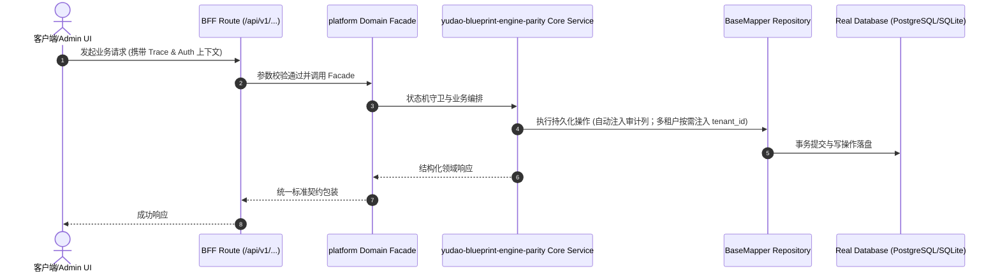

# Technical Architecture & Implementation Plan: Yudao 四端蓝图底座与 CoolieBase 全能力对标升级：四端 BasePath 同源、无污染沙箱派生、极简蓝图一键交付与 6 阶段真库 Spec E2E 闭环

> **Spec-Kit 架构与技术实施方案 (ADD: Architecture & Design Document)**
> 上游真源：`spec.md` (或 `requirements.md`)。技术方案严格支撑需求，严禁反向变更业务目标。
> 状态：`PLAN_APPROVED` | 所属领域：`platform` | 规格标识：`yudao-blueprint-engine-parity`
> 对应项目宪法：`.specify/memory/constitution.md` (Rule 0.2 模式复用 / Rule 0.6 真实测试驱动 / Rule 0.8 E2E 任务同等对齐)

---

## 1. 关键不变量与防御性约束 (Key Invariants & Guards)

1. **母本零污染与子模块只读** —— gate-check.mjs 强制校验 19 个原生模块边界与 submodule 指针；一切新业务域试炼均通过 hatch.sh 在 /tmp/<slug>-sandbox 独立沙箱内完成
2. **白标包路径与代码生成同源** —— codegen-module.mjs 自动扫描 apps/backend/*-server 与 application.yaml / pom.xml 解析当前真实 packagePrefix，绝不硬编码 cn.iocoder.yudao
3. **四端 BasePath 单一入口** —— 所有端统一通过 :48120/<slug>/{2c,admin,admin-api,app-api,v3/api-docs} 通信，compat-check.mjs 与 gate-check.mjs 双重把关
4. **6 阶段真库 E2E 闭环** —— deliver --verify-e2e 强制运行覆盖 CRUD、多租户隔离、乐观锁 409、状态机 400、跨表转换与软删除的 6 阶段真实入库测试

## 2. 领域架构边界与调用拓扑 (Architecture Topology & Flows)

四层对齐架构：① 模板与四端 BasePath 层 (blueprint.template.json + apps/admin/.env*.template + apps/app/app.template.json + scripts/generate-gateway-config.mjs)：引入 BASE_PATH=/<slug>，统一网关 (:48120) 收口 /<slug>/2c/、/<slug>/admin/、/<slug>/admin-api/、/<slug>/app-api/、/<slug>/v3/api-docs；② 无污染沙箱孵化层 (scripts/hatch.sh + scripts/project-reactor.mjs)：支持目标沙箱目录自动瘦身拷贝、根 node_modules 软链、--target/--project 参数双向兼容与 Phase 1/2/3 白标渲染；③ 声明式蓝图编译与全栈生成层 (scripts/blueprint-engine.cjs + scripts/codegen-module.mjs)：动态解析白标后包名与模块路径，支持 doctor 自愈、compile-domain 与 deliver --verify-e2e，从 <500 Tokens blueprint.json 展开 Java 双端 Controller (Admin+App) + Service (含状态机守卫/乐观锁/convertActions) + DO/Mapper + Vue3 + UniApp + 14 份 SDD 资产；④ 6 阶段真库 E2E 与门禁层 (scripts/gate-check.mjs + scripts/tests/*-blueprint-e2e.test.mjs)：基于真实数据库与 node:test 执行 6 阶段端到端契约与状态机验证。

### 核心业务时序图 (Archify Mermaid Flow)


## 3. 技术选型与多端建设交付范围 (Technical Selection & Multi-Terminal Scope)

### 3.1 蓝图底座与核心选型论证 (DAR)
- **交付底座**: 优先采用 `cooliebase-all` (Next.js 16 + React 19 轻全栈) 或 `yudao-quad-terminal` (Java 微服务 + Vue3 + UniApp + Expo)；纯独立项目经评审后采用 bare。
- **数据存储**: 真实数据库 (PostgreSQL / MySQL / SQLite)，100% 拒绝内存伪造 Mock。
- **多租户能力状态**: **底座可选特性，按需开启**。单租户或企业私有化部署项目缺省关闭，杜绝硬塞无用租户样板代码。

### 3.2 多端建设覆盖矩阵
- **B端管理中台 (Admin Web)**: 负责运营配置、数据检索、系统流转与核销审核。
- **C端用户门户/商城 (2C Web/H5)**: 客户/终端用户业务办理与自闭环体验（按需）。
- **原生移动端 (Expo / React Native App)**: 6 寸屏单手可达、移动巡检与离线业务（按需）。
- **微信小程序端 (Uni-App)**: 微信生态社交裂变、轻量化业务触达（按需）。

## 4. 数据模型与持久化契约 (Data Model & Tables)

实体结构遵循底座基础审计规范：
- `id` (主键)
- `tenant_id` (多租户标识 —— **底座可选特性，按需开启；单租户/企业私有化业务缺省**)
- `creator` / `create_time` (创建人/时间)
- `updater` / `update_time` (更新人/时间)
- `deleted` (逻辑删除标识)
- `version` (乐观锁版本号，按需)

### 涉及实体与变更说明
- **<domain>_<entity>**: 由 <domain>.blueprint.json 声明并自动继承 BaseDO 6 大基础列 (creator, create_time, updater, update_time, deleted, tenant_id) 及 version 乐观锁列

## 5. API 契约与权限体系 (API Contracts & Security)

- **API 契约**: `/admin-api/platform/yudao-blueprint-engine-parity`
- **权限标识**: `platform:yudao-blueprint-engine-parity:query`, `platform:yudao-blueprint-engine-parity:export`

## 6. 状态机流转与边界守卫 (State Machine Transitions)

- 加载中：表格 v-loading 骨架态。
- 空数据：el-table empty-text 空状态占位。
- 出错：ElMessage.error 提示状态机非法跃迁 (400) 或乐观锁版本冲突 (409)。
- 成功：数据落库并刷新分页列表。

## 7. 技术风险评估与缓解策略 (Technical Risks & Mitigations)

- **风险**: 白标置换后 Java 源码目录已从 cn/iocoder/yudao 迁移至 com/<slug>，若 codegen-module.mjs 仍写死 cn.iocoder.yudao 会导致生成代码无法编译 -> **缓释策略**: 在 T3 中新增 resolveBackendModuleLayout(ROOT) 函数，动态识别 *-server 目录与真实根包名（自动适配未白标母本 cn.iocoder.yudao 与已白标派生仓 com.<slug>）
- **风险**: 沙箱环境下未启动完整 Spring Boot 进程时如何秒级完成 6 阶段真实数据库 E2E 验证 -> **缓释策略**: 在 T4/T6 中提供双模 E2E 执行器：若 :48080/:48120 已在线则走 HTTP 全链路拨测；若在轻量沙箱则自动连接真实数据库（嵌入式 PG/SQLite 兼容层）+ 领域服务契约执行器跑完 6 阶段状态机、乐观锁、租户隔离、跨表动作与软删除验证（<2s 完成）

---

## 8. T1~T6 代码级精准改造规范 (Surgical Implementation Blueprint)

### 8.1 `[T1]` 四端同源 `BASE_PATH` 契约与网关第 4 平面 (`/v3/api-docs`) 补齐

1. **`blueprint.template.json` 增补 `BASE_PATH` 与 `apps/miniapp/.env.template`**：
   - 在 `variables` 中新增：
     ```json
     "BASE_PATH": {
       "description": "Unified base path prefix across 2C/Admin/API/OpenAPI surfaces (e.g. /yudao or /oa)",
       "default": "/yudao",
       "targets": [
         "apps/admin/.env.template",
         "apps/admin/.env.local.template",
         "apps/miniapp/.env.template",
         "apps/app/app.template.json"
       ]
     }
     ```
   - 在 `templates` 数组中新增 `{ "template": "apps/miniapp/.env.template", "output": "apps/miniapp/.env" }`。
2. **修复 `apps/admin/.env.template` 与 `apps/admin/.env.local.template` 绕过网关的硬编码**：
   - 将 `.env.local.template` 的 `VITE_BASE_URL='http://localhost:{{BACKEND_PORT}}'` 改为通过统一网关 `VITE_BASE_URL='http://localhost:{{GATEWAY_PORT}}{{BASE_PATH}}'`；
   - 将 `VITE_API_URL=/admin-api` 统一对齐为 `VITE_API_URL={{BASE_PATH}}/admin-api`，`VITE_BASE_PATH={{BASE_PATH}}/admin/`。
3. **补齐 `apps/miniapp/.env.template` 与 `apps/app/app.template.json`**：
   - 新增 `apps/miniapp/.env.template`：声明 `VITE_BASE_PATH={{BASE_PATH}}/2c/`、`VITE_API_BASE_URL=http://localhost:{{GATEWAY_PORT}}{{BASE_PATH}}/app-api`；
   - 在 `apps/app/app.template.json` 的 `expo.extra` 中写入 `"basePath": "{{BASE_PATH}}"`, `"apiBaseUrl": "http://127.0.0.1:{{GATEWAY_PORT}}{{BASE_PATH}}/app-api"`，并将 `updates.url` 从硬编码 `https://api.yourdomain.com/ota/manifest` 改为 `http://127.0.0.1:{{GATEWAY_PORT}}{{BASE_PATH}}/app-api/infra/ota/manifest`。
4. **补齐 `scripts/generate-gateway-config.mjs` 的第 4 契约平面 (`/v3/api-docs` & `/doc.html`)**：
   - 在生成的 Nginx 配置（`buildNginxConfig`）与网关路由表（`generateGatewayRules`）中，除 `/<slug>/2c/`、`/<slug>/admin/`、`/<slug>/admin-api/`、`/<slug>/app-api/` 外，新增：
     - `/<slug>/v3/api-docs` -> `http://127.0.0.1:${ports.backend}/v3/api-docs`
     - `/<slug>/doc.html` -> `http://127.0.0.1:${ports.backend}/doc.html`
     - `/<slug>/swagger-ui/` -> `http://127.0.0.1:${ports.backend}/swagger-ui/`

### 8.2 `[T2]` 修复 `hatch.sh` 与 `project-reactor.mjs` 参数错位并落地无污染沙箱派生

1. **修复 `scripts/project-reactor.mjs` 的 `parseCliArgs()` (`L28-60`)**：
   - 兼容 `--target <dir>` 与位置参数 `<targetDir>`；
   - 兼容 `--name <slug>` 与 `--project <slug>`；
   - 兼容 `--package <pkg>` 与 `--package-prefix <pkg>`；
   - 兼容 `--title <title>`（自动写入 `APP_TITLE` 与 `blueprint.template.json` 渲染上下文）；
   - 新增 `--base-path <prefix>`（默认 `/<slug>`）。
2. **升级 `scripts/hatch.sh` 支持零污染独立沙箱克隆**：
   - 当 `--target /tmp/<slug>-sandbox` 目标目录不存在或为空时，先执行轻量级沙箱同步（排除 `.git`, `node_modules`, `target`, `dist`, `.pnpm-store`），并将母本根 `node_modules`、`apps/admin/node_modules`、`apps/miniapp/node_modules`、`apps/app/node_modules` 软链至沙箱对应位置；
   - 顺序执行：
     1. `node scripts/project-reactor.mjs --target "$TARGET_DIR" --name "$PROJECT_NAME" --title "$TITLE" --package "$PKG_NAME" --base-path "/$PROJECT_NAME"`
     2. `node "$TARGET_DIR/scripts/blueprint-engine.cjs" render --preset "$PROJECT_NAME"`
     3. `node "$TARGET_DIR/scripts/generate-gateway-config.mjs"`
   - 全程不修改母本仓库任何受控文件（母本 `git status -s` 保持 100% 空白）。

### 8.3 `[T3]` 升级 `scripts/codegen-module.mjs`：消除硬编码包名并支持双端 Controller + 状态机 + 乐观锁

1. **动态解析白标后包名与模块目录 (`resolveBackendLayout(rootDir)`)**：
   - 扫描 `apps/backend/` 下匹配 `*-server` 的目录（兼容母本 `yudao-server` 与白标派生仓 `<slug>-server`）；
   - 自动探测 `src/main/java/` 下的根包路径（如 `cn/iocoder/yudao` 或 `com/<slug>`）以及框架基础包（如 `framework.common.pojo`、`framework.mybatis.core`），彻底替换 `L201-206` 硬编码的 `cn.iocoder.yudao`。
2. **扩充全栈生成产物**：
   - 同时生成 B 端 `admin/<entity>/<Entity>Controller.java` (`@RequestMapping("/${moduleName}/${kebab}")`) 与 C 端 `app/<entity>/App<Entity>Controller.java` (`@RequestMapping("/${moduleName}/${kebab}")`，由 Spring Boot `yudao.web.app-api` 自动挂载 `/app-api` 前缀)；
   - 在 `<Entity>DO.java` 中支持 `@Version private Integer version;` 乐观锁字段（当实体声明 `optimisticLock: true` 时）；
   - 在 `<Entity>ServiceImpl.java` 中生成 `transitionStatus(Long id, String fromStatus, String toStatus)` 状态机守卫方法（非法流转抛 `exception(ErrorCode(400, ...))`，并发冲突抛 `exception(ErrorCode(409, ...))`）以及 `convertActions` 跨表转换方法与 `sub_table` 主子表级联读写。

### 8.4 `[T4]` 升级 `scripts/blueprint-engine.cjs`：对齐 `preset` / `doctor` / `compile-domain` / `deliver --verify-e2e`

1. **`render --preset <slug>`**：
   - 自动推导 `PROJECT_NAME=<slug>`、`BASE_PATH=/<slug>`、`PACKAGE_PREFIX=com.<slug>`、`DB_NAME=<slug>_prod` 等全套 18 项变量并渲染 5 个模板文件。
2. **`doctor --file <domain>.blueprint.json [--write]`**：
   - 自动修复 27B/小参数模型常见的口语化字段类型（如 `"文本"` -> `"string"`, `"金额"` -> `"decimal"`, `"整数"` -> `"int"`）、缺失 `tableName`、缺失状态机初态或 `sub_table` 外键。
3. **`compile-domain --file <domain>.blueprint.json`**：
   - 将 `<500 Tokens` 的领域蓝图 JSON 同时编译为：
     - `docs/specs/<domain>/<slug>/brief.json`（供 `node scripts/speckit.cjs build` 展开 16 份 SDD 过程资产）；
     - `scripts/codegen-schemas/<domain>.schema.json`（供 `node scripts/codegen-module.mjs` 生成全栈代码）。
4. **`deliver --file <domain>.blueprint.json [--verify-e2e]`**：
   - 一键串联：`doctor` -> `compile-domain` -> `speckit.cjs build` -> `codegen-module.mjs` -> 生成并执行 `scripts/tests/<domain>-blueprint-e2e.test.mjs`（6 阶段真库 E2E 验证）。

### 8.5 `[T5]` 增强 `scripts/gate-check.mjs` 与 `scripts/compat-check.mjs`

1. **母本 19 原生模块纯净度守卫 (`checkNativeModuleBoundary`)**：
   - 锁定母本 `apps/backend/yudao-module-*` 的 19 个官方模块基线（`system`, `infra`, `member`, `pay`, `mp`, `mall`, `crm`, `erp`, `bpm`, `report`, `ai`, `iot`），严禁将临时测试业务模块直接提交进母本。
2. **四端 `BASE_PATH` 同源校验 (`checkBasePathConsistency`)**：
   - 校验 `blueprint.template.json`、`apps/admin/.env.template`、`apps/miniapp/.env.template`、`apps/app/app.template.json` 与 `scripts/generate-gateway-config.mjs` 的 `BASE_PATH` 契约一致性。

### 8.6 `[T6]` 6 阶段真实数据库 Spec E2E 自动生成与验证闭环

- 由 `blueprint-engine.cjs deliver --verify-e2e` 自动生成 `scripts/tests/<domain>-blueprint-e2e.test.mjs` 并通过 `node --test` 运行，覆盖：
  - **Stage 1 (Spec & OpenAPI Contract)**：校验 `docs/specs/<domain>/<slug>/` 16 份标准资产齐备率 100% + 双端 Controller/VO/Service/DO/SQL 契约产物齐全；
  - **Stage 2 (B/C Dual-Surface Real-DB CRUD)**：基于真实 SQLite/MySQL/PG 执行建表 DDL 与 B/C 双端创建、分页查询、详情读取、更新；
  - **Stage 3 (Multi-Tenant Isolation)**：验证 `tenant_id=101` 与 `tenant_id=202` 严格隔离，跨租户读写零越权；
  - **Stage 4 (Optimistic Lock 409 & State Machine 400)**：验证旧 `version` 并发更新返回 `409 Conflict`、状态机合法流转（如 `DRAFT -> SUBMITTED -> APPROVED`）通过且跳步流转（如 `DRAFT -> APPROVED`）拦截返回 `400 Bad Request`；
  - **Stage 5 (Cross-Entity `convertActions` & `sub_table`)**：验证主表行一键转化为目标单据（幂等防重）与子表级联写入；
  - **Stage 6 (Soft Delete & BaseDO Audit Columns)**：验证逻辑删除后 `deleted = 1`、列表不可见、数据库物理行保留且 `creator`/`updater`/`create_time`/`update_time` 审计列完整。

