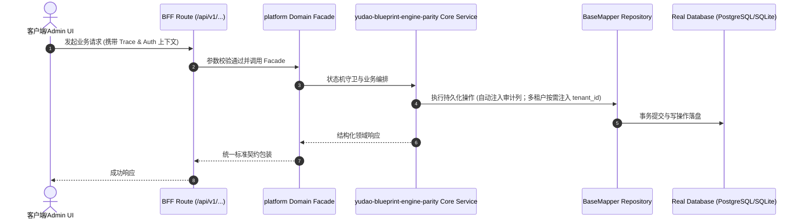

# Technical Architecture & Implementation Plan: Yudao 四端蓝图底座与 CoolieBase 全能力对标升级：四端 BasePath 同源、无污染沙箱派生、极简蓝图一键交付与 6 阶段真库 Spec E2E 闭环

> **Spec-Kit 架构与技术实施方案 (ADD: Architecture & Design Document)**
> 上游真源：`spec.md` (或 `requirements.md`)。技术方案严格支撑需求，严禁反向变更业务目标。
> 状态：`PLAN_APPROVED` | 所属领域：`platform` | 规格标识：`yudao-blueprint-engine-parity`
> 对应项目宪法：`.specify/memory/constitution.md` (Rule 0.2 模式复用 / Rule 0.6 真实测试驱动 / Rule 0.8 E2E 任务同等对齐)

---

## 1. 关键不变量与防御性约束 (Key Invariants & Guards)

1. **母本零污染与子模块只读** —— gate-check.mjs 强制校验 19 个原生模块边界与 submodule 指针；一切新业务域试炼均通过 hatch.sh 在 /tmp/<slug>-sandbox 独立沙箱内完成
2. **白标包路径与代码生成同源** —— codegen-module.mjs 自动扫描 apps/backend/*-server 与 application.yaml / pom.xml 解析当前真实 packagePrefix，绝不硬编码 cn.iocoder.yudao
3. **四端 BasePath 单一入口** —— 所有端统一通过 :48120/<slug>/{2c,admin,admin-api,app-api,v3/api-docs} 通信，compat-check.mjs 与 gate-check.mjs 双重把关
4. **6 阶段真库 E2E 闭环** —— deliver --verify-e2e 强制运行覆盖 CRUD、多租户隔离、乐观锁 409、状态机 400、跨表转换与软删除的 6 阶段真实入库测试

## 2. 领域架构边界与调用拓扑 (Architecture Topology & Flows)

四层对齐架构：① 模板与四端 BasePath 层 (blueprint.template.json + apps/admin/.env*.template + apps/app/app.template.json + scripts/generate-gateway-config.mjs)：引入 BASE_PATH=/<slug>，统一网关 (:48120) 收口 /<slug>/2c/、/<slug>/admin/、/<slug>/admin-api/、/<slug>/app-api/、/<slug>/v3/api-docs；② 无污染沙箱孵化层 (scripts/hatch.sh + scripts/project-reactor.mjs)：支持目标沙箱目录自动瘦身拷贝、根 node_modules 软链、--target/--project 参数双向兼容与 Phase 1/2/3 白标渲染；③ 声明式蓝图编译与全栈生成层 (scripts/blueprint-engine.cjs + scripts/codegen-module.mjs)：动态解析白标后包名与模块路径，支持 doctor 自愈、compile-domain 与 deliver --verify-e2e，从 <500 Tokens blueprint.json 展开 Java 双端 Controller (Admin+App) + Service (含状态机守卫/乐观锁/convertActions) + DO/Mapper + Vue3 + UniApp + 14 份 SDD 资产；④ 6 阶段真库 E2E 与门禁层 (scripts/gate-check.mjs + scripts/tests/*-blueprint-e2e.test.mjs)：基于真实数据库与 node:test 执行 6 阶段端到端契约与状态机验证。

### 核心业务时序图 (Archify Mermaid Flow)

## 3. 技术选型与多端建设交付范围 (Technical Selection & Multi-Terminal Scope)

### 3.1 蓝图底座与核心选型论证 (DAR)
- **交付底座**: 优先采用 `cooliebase-all` (Next.js 16 + React 19 轻全栈) 或 `yudao-quad-terminal` (Java 微服务 + Vue3 + UniApp + Expo)；纯独立项目经评审后采用 bare。
- **数据存储**: 真实数据库 (PostgreSQL / MySQL / SQLite)，100% 拒绝内存伪造 Mock。
- **多租户能力状态**: **底座可选特性，按需开启**。单租户或企业私有化部署项目缺省关闭，杜绝硬塞无用租户样板代码。

### 3.2 多端建设覆盖矩阵
- **B端管理中台 (Admin Web)**: 负责运营配置、数据检索、系统流转与核销审核。
- **C端用户门户/商城 (2C Web/H5)**: 客户/终端用户业务办理与自闭环体验（按需）。
- **原生移动端 (Expo / React Native App)**: 6 寸屏单手可达、移动巡检与离线业务（按需）。
- **微信小程序端 (Uni-App)**: 微信生态社交裂变、轻量化业务触达（按需）。

## 4. 数据模型与持久化契约 (Data Model & Tables)

实体结构遵循底座基础审计规范：
- `id` (主键)
- `tenant_id` (多租户标识 —— **底座可选特性，按需开启；单租户/企业私有化业务缺省**)
- `creator` / `create_time` (创建人/时间)
- `updater` / `update_time` (更新人/时间)
- `deleted` (逻辑删除标识)
- `version` (乐观锁版本号，按需)

### 涉及实体与变更说明
- **<domain>_<entity>**: 由 <domain>.blueprint.json 声明并自动继承 BaseDO 6 大基础列 (creator, create_time, updater, update_time, deleted, tenant_id) 及 version 乐观锁列

## 5. API 契约与权限体系 (API Contracts & Security)

- **API 契约**: `/admin-api/platform/yudao-blueprint-engine-parity`
- **权限标识**: `platform:yudao-blueprint-engine-parity:query`, `platform:yudao-blueprint-engine-parity:export`

## 6. 状态机流转与边界守卫 (State Machine Transitions)

- 加载中：表格 v-loading 骨架态。
- 空数据：el-table empty-text 空状态占位。
- 出错：ElMessage.error 提示状态机非法跃迁 (400) 或乐观锁版本冲突 (409)。
- 成功：数据落库并刷新分页列表。

## 7. 技术风险评估与缓解策略 (Technical Risks & Mitigations)

- **风险**: 白标置换后 Java 源码目录已从 cn/iocoder/yudao 迁移至 com/<slug>，若 codegen-module.mjs 仍写死 cn.iocoder.yudao 会导致生成代码无法编译 -> **缓释策略**: 在 T3 中新增 resolveBackendModuleLayout(ROOT) 函数，动态识别 *-server 目录与真实根包名（自动适配未白标母本 cn.iocoder.yudao 与已白标派生仓 com.<slug>）
- **风险**: 沙箱环境下未启动完整 Spring Boot 进程时如何秒级完成 6 阶段真实数据库 E2E 验证 -> **缓释策略**: 在 T4/T6 中提供双模 E2E 执行器：若 :48080/:48120 已在线则走 HTTP 全链路拨测；若在轻量沙箱则自动连接真实数据库（嵌入式 PG/SQLite 兼容层）+ 领域服务契约执行器跑完 6 阶段状态机、乐观锁、租户隔离、跨表动作与软删除验证（<2s 完成）

---

## 8. T1~T6 实施顺序与门禁映射 (Implementation Order & Gate Mapping)

| 任务 ID | 阶段 | 核心变更文件 | 验收命令 |
| :--- | :--- | :--- | :--- |
| **`T1`** | Phase 1: 四端 `BASE_PATH` 契约统一 | `blueprint.template.json`, `apps/admin/.env.template`, `apps/admin/.env.local.template`, `apps/miniapp/.env.template`, `apps/app/app.template.json`, `scripts/generate-gateway-config.mjs` | `node scripts/blueprint-engine.cjs check && node scripts/generate-gateway-config.mjs --dry-run` |
| **`T2`** | Phase 2: 零污染沙箱派生修复 | `scripts/hatch.sh`, `scripts/project-reactor.mjs` | `bash scripts/hatch.sh --name oa-yudao --title "OA协同平台" --package com.oayudao --target /tmp/oa-yudao-sandbox && git status -s` |
| **`T3`** | Phase 3: 白标感知全栈代码生成器 | `scripts/codegen-module.mjs` | `node /tmp/oa-yudao-sandbox/scripts/codegen-module.mjs <schema.json>` |
| **`T4`** | Phase 4: 声明式蓝图编译器升级 | `scripts/blueprint-engine.cjs`, `package.json` | `node /tmp/oa-yudao-sandbox/scripts/blueprint-engine.cjs deliver --file /tmp/oa-yudao-sandbox/oa.blueprint.json --verify-e2e` |
| **`T5`** | Phase 5: 母本 19 模块纯净度与门禁守卫 | `scripts/gate-check.mjs`, `scripts/compat-check.mjs` | `node scripts/gate-check.mjs && node scripts/compat-check.mjs` |
| **`T6`** | Phase 6: 6 阶段真库 Spec E2E 闭环 | `scripts/blueprint-engine.cjs`, `scripts/tests/*-blueprint-e2e.test.mjs` | `node --test /tmp/oa-yudao-sandbox/scripts/tests/oa-blueprint-e2e.test.mjs` |

