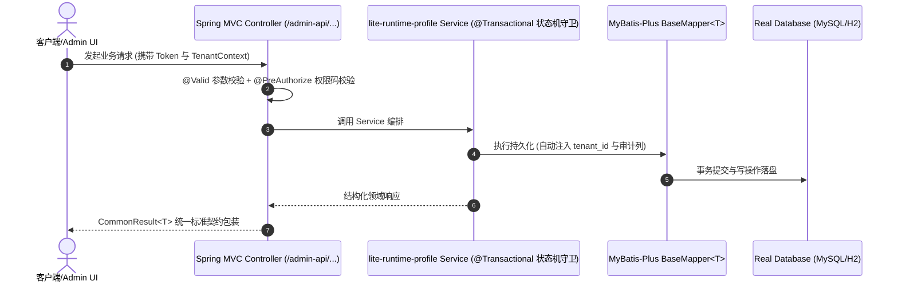

# Technical Architecture & Implementation Plan: 零 Docker 单机轻量运行档（嵌入式真 PostgreSQL + 嵌入式真 Redis，后端子模块零改动）

> **Spec-Kit 架构与技术实施方案 (ADD: Architecture & Design Document)**
> 上游真源：`spec.md` (或 `requirements.md`)。技术方案严格支撑需求，严禁反向变更业务目标。
> 状态：`PLAN_APPROVED` | 所属领域：`platform` | 规格标识：`lite-runtime-profile`
> 对应项目宪法：`.specify/memory/constitution.md` (Rule 0.2 模式复用 / Rule 0.6 真实测试驱动)

---

## 1. 关键不变量与防御性约束 (Key Invariants & Guards)

1. **子模块零改动** —— lite 全部差异落主仓 deploy/lite/ 与 scripts/；验收用『启动前后 git -C apps/backend status --porcelain 均为空』硬校验
2. **零弱默认凭据** —— 用户名与密码均由 CSPRNG 生成（拒绝采样消除取模偏置），bcrypt 哈希后写库；凭据文件 0600 且 gitignore；验收用『admin/admin123 登录必须失败』反证
3. **真实引擎而非替身** —— PG 与 Redis 都必须是真的：PG 为 18.4 官方二进制，Redis 为真 redis-server 7.4.1；验收用 INFO 版本号与关键命令实测，禁止模拟器
4. **零 Docker 零外部服务** —— 两个依赖都在本进程生命周期内由编排器拉起并成对回收；验收在本项目 compose 无容器时执行
5. **二进制与凭据不入库** —— redis 二进制、PG 数据目录、凭据文件全部落 .commandcode/lite/ 并被 .gitignore 排除

## 2. 领域架构边界与调用拓扑 (Architecture Topology & Flows)

主仓交付物 → deploy/lite/runtime/（自包含 node 运行时：embedded-postgres 18.4 + pg + bcryptjs，含 lite-pg.mjs 与 lite-credentials.mjs）+ deploy/lite/application-lite.yaml（外置配置，经 --spring.config.additional-location=file:./deploy/lite/ 注入）+ scripts/lite-up.mjs（编排器）。启动链路：lite-up.mjs → ① 预检 PG 运行时与 fat jar ② 按平台从 Maven 制品抽取真 redis-server 二进制到 .commandcode/lite/bin/ 并拉起 ③ 拉起嵌入式 PG（数据目录 .commandcode/lite/pgdata）④ 建库并导入官方 apps/backend/sql/postgresql/{ruoyi-vue-pro,quartz}.sql ⑤ 读取/生成 CSPRNG 引导凭据并把 DB 内 id=1 账号改名改密、禁用其余弱演示账号 ⑥ 以 -cp '<fatjar>:<pg-driver.jar>' org.springframework.boot.loader.launch.JarLauncher 启动（PG 驱动为 optional，未打进 fat jar）⑦ 用生成的引导凭据探活登录。数据面：jdbc:postgresql://127.0.0.1:<port>/ruoyi-vue-pro；缓存面：redis://127.0.0.1:<port>（真 Redis 7.4.1）。id 策略：PG 被 IdTypeEnvironmentPostProcessor 自动置 INPUT，仓内 547 个文件已有 @KeySequence。

### 核心业务时序图 (Archify Mermaid Flow)

## 3. 数据模型与持久化契约 (Data Model & Tables)

实体结构严格遵循底座审计底座字段规范 (`BaseDO` / `TenantBaseDO` 自动继承)：
- `id` (主键，`IdTypeEnvironmentPostProcessor` 按数据库方言自适应)
- `creator` / `create_time` (创建人/时间)
- `updater` / `update_time` (更新人/时间)
- `deleted` (逻辑删除标识)
- `tenant_id` (多租户标识，由 MyBatis-Plus 租户插件自动注入与过滤)
- `version` (乐观锁版本号，**仅并发写实体需要，非全表必备**)

### 涉及实体与变更说明
- **全部 60 张表（复用官方 PG 脚本）**: 直接执行 apps/backend/sql/postgresql/ruoyi-vue-pro.sql，不手写任何 DDL；实测 tables=60 / sequences=48 / system_users=21 / system_menu=2162
- **system_users**: 导入后立即改写：id=1 账号用户名与密码换成 CSPRNG 高熵值；id<>1 的种子弱演示账号 status 置 1（禁用）
- **QRTZ_* 定时任务表**: 来自 apps/backend/sql/postgresql/quartz.sql；lite 档关闭 xxl-job 但保留结构避免启动校验失败

## 4. API 契约与权限体系 (API Contracts & Security)

- **API 契约**: `/admin-api/platform/lite-runtime-profile`
- **权限标识**: `platform:lite-runtime-profile:query`, `platform:lite-runtime-profile:export`

## 5. 状态机流转与边界守卫 (State Machine Transitions)

- dry-run：打印将执行的确切步骤与依赖检查结果，不启动任何进程。
- 预检失败：明确列出缺失项（PG 运行时装未装 / Redis 制品不可抽取 / fat jar 不存在 / PG 驱动缺失）并退出。
- 启动中：输出 PG 端口与数据目录、Redis 端口、导入的 SQL 脚本路径、java 命令与 profile。
- 就绪：打印登录探活结果（200 + 是否含 accessToken）。
- 退出：Ctrl-C 触发 Redis 与 java 进程的成对清理。

## 6. 技术风险评估与缓解策略 (Technical Risks & Mitigations)

- **风险**: Redis 7.4.1 采用 RSALv2/SSPLv1，若 lite 运行时被随交付物对外分发或用于对外提供 Redis 兼容托管服务，将越界许可。 -> **缓释策略**: README 与脚本首屏声明适用范围；DAR 中明确记录此为『本地开发/演示』决策；分发前必须切换到 Redis 6.2.6（BSD-3）或 Valkey 并重开评审。
- **风险**: 承载 Redis 二进制的上游仓库（lansheng228/embedded-redis）在 GitHub 上无法核验，存在供应链风险。 -> **缓释策略**: 二进制不入库，运行时抽取；抽取后校验文件格式并实跑 --version 与关键命令；记录制品坐标供审计追溯。
- **风险**: 嵌入式 redis-server 为 7.4.1，而生产 compose 为 redis:7.2，存在版本差。 -> **缓释策略**: 只使用两版本共有的稳定命令族；lite 不启用持久化与集群特性；版本差记入 README 已知差异。
- **风险**: PG 驱动为 optional，未打进 fat jar，直接 java -jar 会因缺少驱动而失败。 -> **缓释策略**: 编排器以 -cp '<fatjar>:<pg-driver.jar>' 配合 JarLauncher 启动，并显式预检驱动 jar 是否存在。
- **风险**: 引导凭据文件被误提交或被同机其他用户读取。 -> **缓释策略**: 写入时 mode 0600 并显式 chmod；目录 .commandcode/lite/ 已加入 .gitignore；验收含权限与未入库校验。
