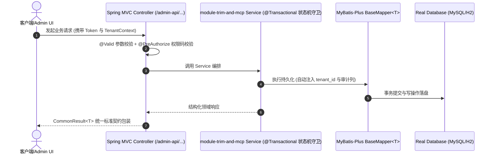

# Technical Architecture & Implementation Plan: 模块裁剪工具化与 Agent 可编排 MCP 端点

> **Spec-Kit 架构与技术实施方案 (ADD: Architecture & Design Document)**
> 上游真源：`spec.md` (或 `requirements.md`)。技术方案严格支撑需求，严禁反向变更业务目标。
> 状态：`PLAN_APPROVED` | 所属领域：`platform` | 规格标识：`module-trim-and-mcp`
> 对应项目宪法：`.specify/memory/constitution.md` (Rule 0.2 模式复用 / Rule 0.6 真实测试驱动)

---

## 1. 关键不变量与防御性约束 (Key Invariants & Guards)

1. **裁剪元数据单一真源** —— CLI 与 MCP server 都引用 scripts/lib/module-catalog.mjs；MCP 不复制任何模块元数据，验收用 acceptance 第 6 条与 code review 白名单约束
2. **依赖闭包完整** —— --keep 触发 deps 闭包自动扩张，--remove 与闭包冲突时 exit 2；验收用 --keep system 反例覆盖
3. **破坏性操作可回退** —— 备份写主仓 .commandcode/backups/，git 工作区脏时拒绝执行，--recover 提供一键还原；验收用 acceptance 第 4、5 条覆盖
4. **子模块零污染** —— apps/backend 是 git submodule，工具不在其工作树留 .bak；裁剪的『本地消费态』语义在 dry-run/apply 输出与 SKILL §5 显式标注，避免误以为装配已固化

## 2. 领域架构边界与调用拓扑 (Architecture Topology & Flows)

Agent/CI → (MCP stdio server | CLI) → scripts/lib/module-catalog.mjs（唯一元数据真源：19 模块 + 依赖闭包 + profiles）→ 三处落地：apps/backend/pom.xml 的 <module> 节点、apps/backend/yudao-server/pom.xml 的依赖声明、物理目录 apps/backend/yudao-module-*。校验方向相反：--check 从磁盘与 pom 回读现状，与目标 profile 比对后判定漂移。⚠️ apps/backend 是 git submodule（上游 YunaiV/yudao-cloud，branch master-jdk17），裁剪因此只是『本地消费态』：结果会被 git submodule update / scripts/sync-upstream.sh 还原。工具据此把备份写到主仓 .commandcode/backups/（不在子模块工作树留 .bak），并提供 --recover 一键还原。

### 核心业务时序图 (Archify Mermaid Flow)

## 3. 数据模型与持久化契约 (Data Model & Tables)

实体结构严格遵循底座审计底座字段规范 (`BaseDO` / `TenantBaseDO` 自动继承)：
- `id` (主键，`IdTypeEnvironmentPostProcessor` 按数据库方言自适应)
- `creator` / `create_time` (创建人/时间)
- `updater` / `update_time` (更新人/时间)
- `deleted` (逻辑删除标识)
- `tenant_id` (多租户标识，由 MyBatis-Plus 租户插件自动注入与过滤)
- `version` (乐观锁版本号，**仅并发写实体需要，非全表必备**)

### 涉及实体与变更说明
- **system_menu**: 被裁模块的顶级菜单与孤儿父子链需删除（先删子后删父，或递归清理 parent_id 悬空行）
- **system_role_menu**: 清理已移除菜单的角色映射，避免角色持有空权限
- **system_dict_type / system_dict_data**: 清理被裁模块的字典类型与字典数据（按 type/dict_type 前缀）

## 4. API 契约与权限体系 (API Contracts & Security)

- **API 契约**: `/admin-api/platform/module-trim-and-mcp`
- **权限标识**: `platform:module-trim-and-mcp:query`, `platform:module-trim-and-mcp:export`

## 5. 状态机流转与边界守卫 (State Machine Transitions)

- dry-run：打印计划表，不做任何写入。
- apply 成功：打印已删目录数、剩余模块、剩余 Java 文件数与冷编译预估变化。
- check 通过：exit 0 并列出当前 profile。
- check 漂移：exit 1 并逐条列出漂移项（目录 / pom 节点）。

## 6. 技术风险评估与缓解策略 (Technical Risks & Mitigations)

- **风险**: 裁剪后跨模块编译断裂（例如保留了依赖 bpm 的模块却裁掉 bpm）。 -> **缓释策略**: 依赖闭包自动扩张 + 冲突显式拒绝（exit 2）+ --check 漂移门禁三重护栏。
- **风险**: apps/backend 是 git submodule：trim 结果会被 git submodule update / scripts/sync-upstream.sh 静默还原，使用方误以为装配已固化。 -> **缓释策略**: 工具在 dry-run 与 apply 输出显式告警子模块语义并提供 --recover；--check 可随时复验；SKILL §5/§8.5 同步标注。
- **风险**: 能力再次退回文档（在 SKILL.md 里重写 bash 模板），导致文档与脚本分叉。 -> **缓释策略**: 删除 bootstrap SKILL 的假 bash 模板改为指针，并在 wiki 注册 yudao-mcp-server 技能固定入口。
